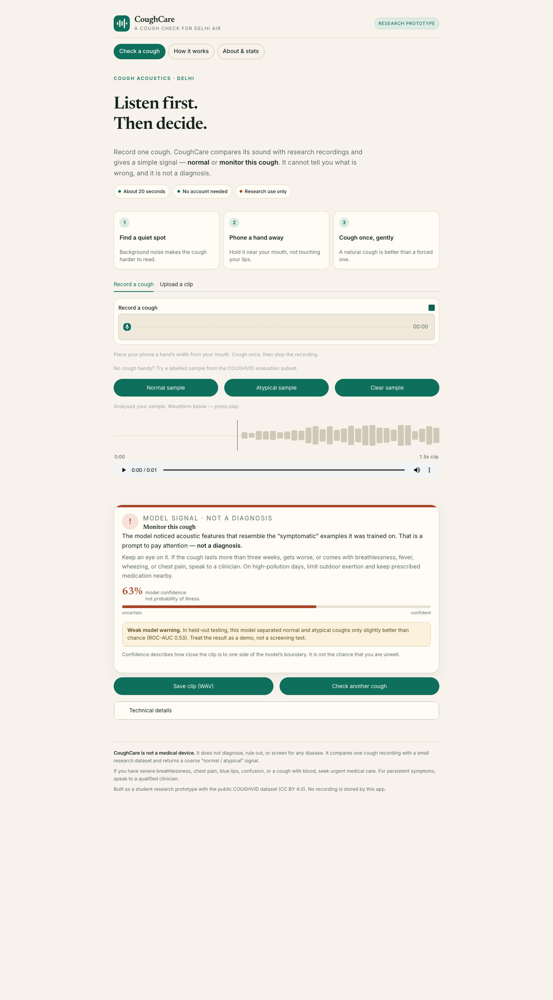
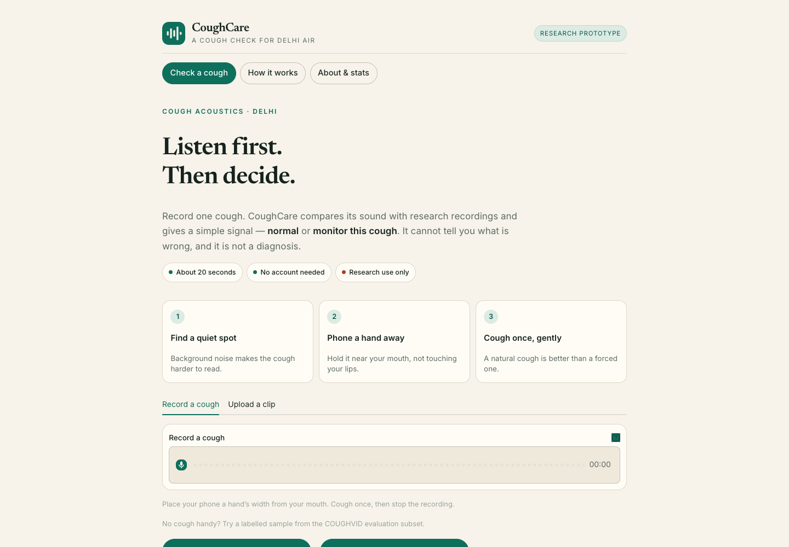
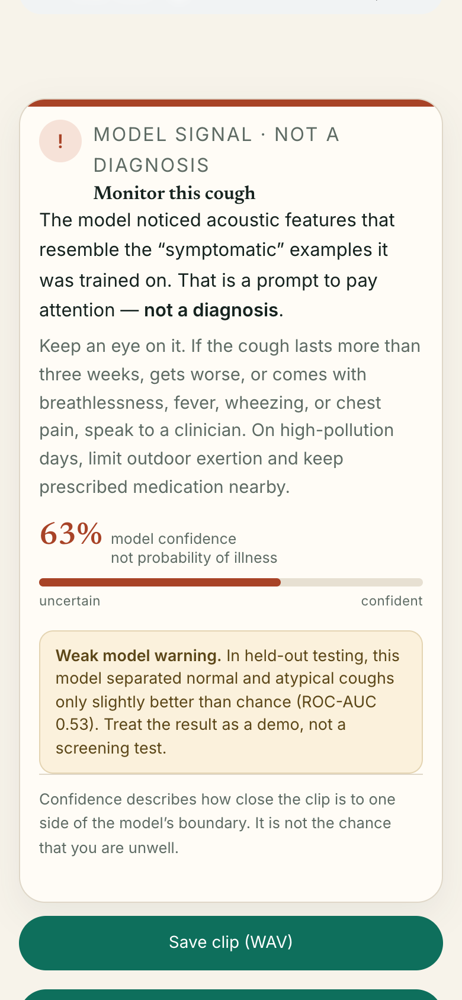
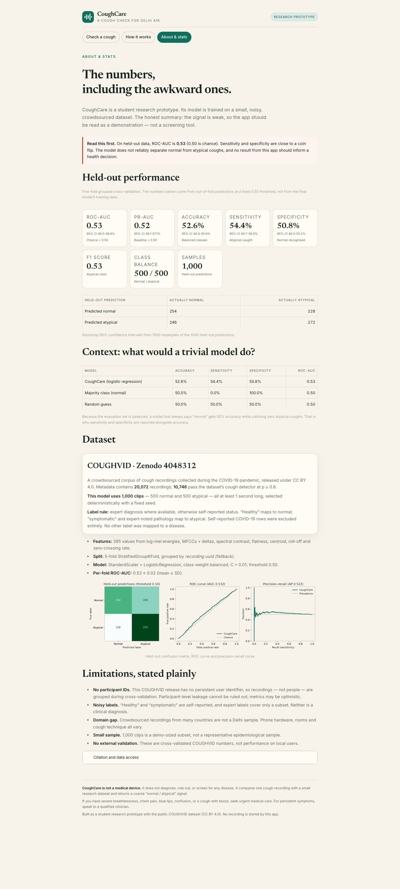
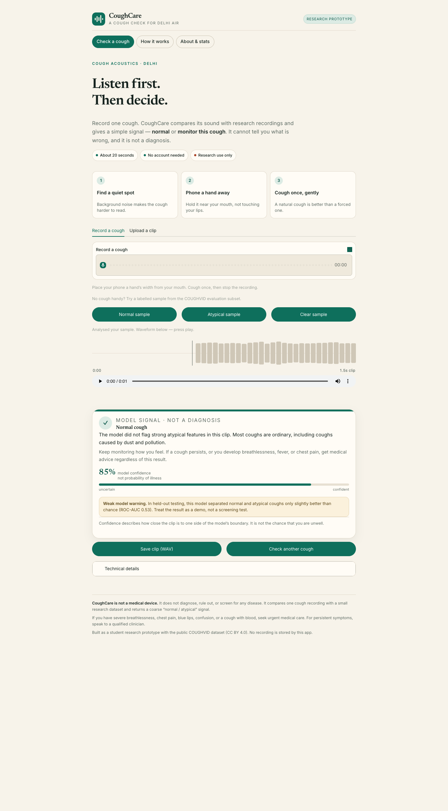
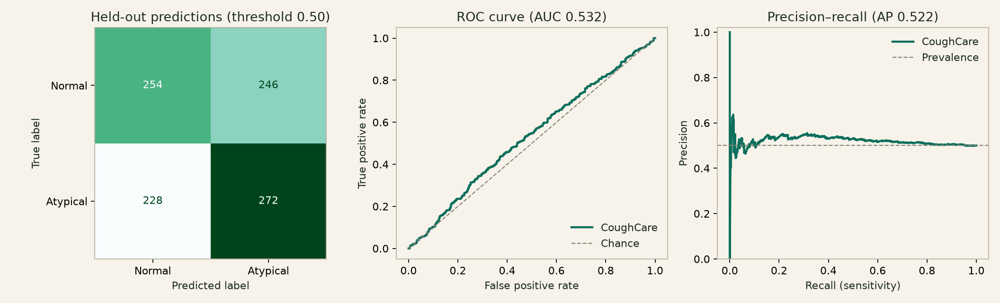

# CoughCare

**A cough-check research prototype for Delhi students.** Record one cough; the app
compares its acoustics with labelled COUGHVID recordings and returns one of two
signals — **“Normal cough”** or **“Monitor this cough”** — with a model confidence
score and a scrolling waveform.

> **CoughCare is not a medical device.** It does not diagnose, rule out, or screen
> for any disease. It classifies one short audio clip as “normal” or “atypical”
> relative to a small, noisy research dataset. The held-out signal is weak
> (ROC-AUC **0.53**), and the app says so prominently. See [Honest results](#honest-results).



---

## Contents

- [What it does](#what-it-does)
- [Quick start](#quick-start)
- [Environment inspection](#environment-inspection)
- [Dataset](#dataset)
- [Labels and sampling](#labels-and-sampling)
- [Features and model](#features-and-model)
- [Honest results](#honest-results)
- [Limitations](#limitations)
- [App and design](#app-and-design)
- [Tests and screenshots](#tests-and-screenshots)
- [Deployment: public link](#deployment-public-link)
- [Repository layout](#repository-layout)
- [Citation and licence](#citation-and-licence)

---

## What it does

- **Record or upload** one cough (WAV, MP3, M4A, OGG, WebM, FLAC) in a mobile-first
  Streamlit interface.
- Extracts the loudest 1.5-second cough window and computes 395 audio features
  (log-mel statistics, MFCCs + deltas, spectral shape).
- Runs a class-balanced logistic regression trained on a **1,000-clip balanced
  subset** of COUGHVID with **5-fold grouped cross-validation**.
- Shows a **scrolling waveform** during playback, a plain-language result, a
  confidence score, quality warnings, and technical details.
- Has an **About & stats** page with the confusion matrix, ROC/PR curves,
  bootstrap 95% CIs, baselines, dataset description, and limitations.
- Includes two labelled sample clips so the flow can be demonstrated without a
  microphone.
- Falls back to a **clearly marked demo mode** (transparent heuristic, no trained
  model) if the model artefact is missing or `COUGHCARE_DEMO=1`.

**It does not:** detect COVID-19, TB, asthma, pneumonia, infection, or any other
disease; measure lung function or air-pollution exposure; replace a clinician.

### Screens

| Home | Mobile result |
|---|---|
|  |  |

| Stats | Normal result |
|---|---|
|  |  |

---

## Quick start

Requires Python 3.11–3.13 and ~2 GB free disk for the dataset.

```bash
cd coughcare
python3 -m venv .venv
source .venv/bin/activate
pip install -r requirements.txt

# 1. Download, verify and extract COUGHVID (951 MB; resumable)
python scripts/download_data.py

# 2. Build the deterministic balanced manifest
python scripts/prepare_data.py

# 3. Extract features, run 5-fold CV, save model + metrics + figures
python scripts/train_model.py

# 4. Run the app
streamlit run app.py
```

Open <http://localhost:8501>. The trained model (`models/coughcare_lr.joblib`),
metrics (`reports/metrics.json`), figures and screenshots are committed, so you
can run the app **without** downloading the dataset:

```bash
pip install -r requirements.txt
streamlit run app.py
```

Use `COUGHCARE_DEMO=1 streamlit run app.py` to force the labelled demo heuristic.

### Sample demo URLs

- `http://localhost:8501/?sample=atypical` — auto-loads the atypical sample.
- `http://localhost:8501/?sample=normal` — auto-loads the normal sample.
- `http://localhost:8501/?page=stats` — opens About & stats.
- `http://localhost:8501/?page=how` — opens How it works.

---

## Environment inspection

The build was started by listing the working directory and checking the Python
environment. Result at build time:

| Check | Result |
|---|---|
| Working directory | `/Users/aanishkathacker/coughcare` (created for this project) |
| OS | macOS 15.6, arm64 |
| Python | 3.13.15 (`.venv`) |
| Package manager | pip 26.2.1 |
| Git | 2.39.5 |
| Environment variables | 35 total; no API keys or unexpected secrets |
| Free disk | 26 GB before download |
| ffmpeg on PATH | not present — handled by PyAV, which bundles FFmpeg |

Reproduce the checks:

```bash
pwd && ls -la
python3 --version && pip --version && git --version
env | sort | wc -l
```

---

## Dataset

**COUGHVID** — *The COUGHVID crowdsourcing dataset: A corpus for the study of
large-scale cough analysis algorithms* (Orlandic, Arora & Idelchik, *Scientific
Data* 8, 156, 2021).

- Zenodo record **4048312**, file `public_dataset.zip`
- Size **951,442,487 bytes**
- MD5 **`5c30a8b00c8bb7783a2c15a48cb8ea9e`** (verified)
- Zip integrity test passed; 40,145 members extracted
- Licence: **CC BY 4.0**
- 20,072 metadata rows; **10,746** clips pass `cough_detected >= 0.8`
- Audio: short Opus recordings in `.webm`/`.ogg`, 48 kHz

`scripts/download_data.py` downloads with resume support (`urllib`), verifies
size + MD5, runs `ZipFile.testzip()`, and extracts. The dataset is **not**
committed; see `data/README.md`.

```bash
python scripts/download_data.py --skip-download   # verify + extract an existing zip
```

The script downloads from:

```
https://zenodo.org/records/4048312/files/public_dataset.zip
```

---

## Labels and sampling

**Label rule** (`src/coughcare/data.py`):

1. Self-reported `COVID-19` rows are **excluded entirely**.
2. Expert diagnosis (JSON or flattened `diagnosis_1..3` columns) takes priority
   when available and quality is acceptable:
   - `healthy_cough`, `healthy`, `normal` → **normal (0)**
   - `lower_infection`, `upper_infection`, `obstructive_disease`, other pathology
     → **atypical (1)**
   - expert `COVID-19` diagnoses are **ignored**, never mapped to a target.
3. Otherwise self-reported `healthy` → **normal**; `symptomatic` → **atypical**.
4. Anything else is dropped.

No unrelated label (COVID status, age, gender, geography) is mapped to a disease.
The only target is **normal vs atypical cough**.

**Sampling:** valid coughs (`cough_detected >= 0.8`), duration **1–15 s**,
deterministic seed 42, **500 normal + 500 atypical = 1,000 clips**. Full clip
duration is probed (COUGHVID WebM files often have no container duration, so the
probe decodes frames).

**Split:** 5-fold `StratifiedGroupKFold`. The loader supports a participant column
(`user_id`, `participant_id`, `subject_id`, `device_id`) when present. **This
COUGHVID release has no participant identifier**, so the recording UUID is used
as the group and the limitation is disclosed in `metrics.json`, the app, and
below. Participant-level leakage cannot be fully ruled out.

Selected manifest composition: 572 self-reported healthy, 387 self-reported
symptomatic, 41 expert-labelled with no self-report. Final labels are 500/500.

---

## Features and model

- 1.5 s highest-energy window, peak-normalised.
- 395 features:
  - 64-band log-mel: mean, SD, p10, p90 per band (256)
  - 20 MFCCs: mean, SD, p10, p90 (80), plus delta mean/SD (40)
  - centroid, bandwidth, roll-off, flatness, ZCR, RMS statistics (12)
  - spectral contrast (7)
- `StandardScaler` + `LogisticRegression(class_weight="balanced", C=0.01,
  max_iter=5000)`.
- Nested grouped CV: outer 5 folds; inner 3-fold grouped grid search over
  `C ∈ {0.01, 0.03, 0.1, 0.3, 1, 3}`. The final model uses the modal outer-fold
  choice (`C=0.01`, chosen in 4/5 folds). Reported metrics are **out-of-fold**
  predictions at a fixed 0.50 threshold.
- 95% CIs from 1,000 bootstrap resamples of the held-out predictions.
- Baselines: majority class and random chance.

---

## Honest results

**The model is weak.** ROC-AUC 0.532 with a 95% CI of 0.495–0.568 includes chance.
Sensitivity and specificity are close to a coin flip. This is reported as-is; no
metrics were fabricated or cherry-picked.

**Class balance:** 500 normal / 500 atypical (50/50).

| Metric | Value | Bootstrap 95% CI |
|---|---:|---:|
| Accuracy | 52.6% | 49.4–55.9% |
| Sensitivity (atypical recall) | 54.4% | 49.7–58.9% |
| Specificity (normal recall) | 50.8% | 46.3–55.2% |
| ROC-AUC | 0.532 | 0.495–0.568 |
| PR-AUC | 0.522 | 0.481–0.571 |
| F1 (atypical) | 0.534 | — |
| Mean fold ROC-AUC | 0.531 ± 0.016 | — |

**Confusion matrix** (held-out, threshold 0.50):

|  | Actually normal | Actually atypical |
|---|---:|---:|
| Predicted normal | 254 (TN) | 228 (FN) |
| Predicted atypical | 246 (FP) | 272 (TP) |

**Baselines:**

| Model | Accuracy | Sensitivity | Specificity | ROC-AUC |
|---|---:|---:|---:|---:|
| CoughCare | 52.6% | 54.4% | 50.8% | 0.532 |
| Majority class (“normal”) | 50.0% | 0.0% | 100.0% | 0.500 |
| Random guess | 50.0% | 50.0% | 50.0% | 0.500 |



The app displays a **“Weak model warning”** on every real-model result and a
**“Close call”** note when confidence < 60%. The two labels are about the clip,
not the person, and are never presented as a diagnosis.

Reproduce the report:

```bash
python scripts/train_model.py
cat reports/metrics.json
```

Outputs: `models/coughcare_lr.joblib`, `reports/metrics.json`,
`reports/oof_predictions.csv`, `reports/figures/*.png`.

---

## Limitations

- **Weak signal.** Near-chance held-out performance; not suitable for screening.
- **No participant IDs** in this COUGHVID release; grouping uses recording UUID.
  Metrics may be optimistic if one person contributed multiple recordings.
- **Noisy labels.** Healthy/symptomatic is self-reported; expert labels cover a
  subset and are not clinical ground truth.
- **Domain gap.** Crowdsourced clips from many countries/devices, not a Delhi
  sample. Microphone, room and cough technique change the features.
- **Small subset.** 1,000 clips is demo-sized, not epidemiological.
- **No external validation.** All numbers are cross-validated COUGHVID numbers.
- **Audio engineering is simple.** Loudest-window selection can miss a cough or
  pick a non-cough transient; there is no cough detector at inference time.
- **Not for emergencies.** Severe breathlessness, chest pain, blue lips or
  coughing blood needs urgent medical care.

---

## App and design

Built with **Streamlit** and custom CSS. Theme:

- **Background:** warm off-white `#F7F3EA`; surfaces `#FFFCF6`
- **Ink:** `#16231F`; muted `#5E6B64`
- **Single accent:** deep teal `#0E6F5C`; soft `#DCEBE4`
- **Alert:** rust `#A84327` (not used as the only signal — labels and icons too)
- **Fonts:** *Newsreader* (display serif) + *Inter* (UI sans), with Georgia and
  system-ui fallbacks if Google Fonts is unavailable
- **Contrast:** body text and buttons meet WCAG AA; focus outlines preserved
- **Mobile:** single column, wrapping nav pills, 44px+ tap targets, responsive
  stats grid, stacked steps, 390px-tested layout
- **Custom assets:** `assets/logo.svg`, `assets/logo.png`, `assets/theme.css`,
  `assets/samples/*.webm`, and a self-contained canvas waveform player (no CDN
  JavaScript).

Friendly microcopy is used throughout: *“Place your phone a hand’s width from your
mouth. Cough once, then stop the recording.”* Errors are caught and translated
into actionable messages (silent clip, too short, decode failure, oversized file).

The WAV player shows a waveform that **scrolls under a fixed playhead** while the
clip plays, built with vanilla canvas + `requestAnimationFrame`.

---

## Tests and screenshots

```bash
pytest -q
# 25 passed
```

Coverage includes audio decoding (WAV bytes/path, WebM, silence rejection), fixed
window extraction, waveform peaks, feature shape/finiteness, label mapping for
both metadata layouts (JSON and flattened expert columns), filtering/balancing,
metrics + bootstrap CIs, baselines, the HTML waveform component, real model
prediction contracts, and a Streamlit `AppTest` smoke test.

Screenshots in `screenshots/` were captured from the running app with Playwright
driving local Chrome:

| File | What it shows |
|---|---|
| `01_home_desktop.png` | Home / recording flow |
| `02_result_atypical_desktop.png` | Atypical result, waveform, warning |
| `03_result_normal_desktop.png` | Normal result |
| `04_stats_desktop.png` | About & stats, metrics and figures |
| `05_home_mobile.png` | 390 px mobile home |
| `06_result_atypical_mobile.png` | Mobile result card |
| `07_upload_result_desktop.png` | Real file-upload path (not sample shortcut) |
| `08_stats_mobile.png` | Mobile stats top |

Regenerate (requires the app running and `pip install playwright`):

```bash
streamlit run app.py --server.headless true &
python scripts/capture_screenshots.py
```

**Validation performed:** started the app locally, loaded both sample clips,
uploaded a WebM from the evaluation subset through the real uploader, confirmed
classification + confidence + waveform rendered, navigated to stats, checked the
mobile layout, and confirmed **no browser console errors**. The classifier’s
output on the uploaded sample was **normal** with 53% confidence — a
misclassification, which is consistent with the near-chance metrics and is
reported rather than hidden.

---

## Deployment: public link

**Status:** deployment is fully prepared, but **no public app was published in
this session** and no account credentials were used. The steps below create a
public URL. A GitHub CLI login exists on this machine, but publishing a repository
is a real-world action and was not performed without confirmation.

The app only needs `app.py`, `src/`, `assets/`, `models/coughcare_lr.joblib` and
`reports/metrics.json` + `reports/figures/`. The 951 MB dataset is **not** needed
at runtime.

### Option A — Streamlit Community Cloud (recommended)

1. Create a public GitHub repository and push:

   ```bash
   cd coughcare
   gh repo create coughcare --public --source=. --remote=origin --push
   # or: git remote add origin https://github.com/<you>/coughcare.git && git push -u origin main
   ```

2. Go to <https://share.streamlit.io> and sign in with GitHub.
3. Click **Create app** → **Deploy a public app from GitHub**.
4. Set:
   - Repository: `<you>/coughcare`
   - Branch: `main`
   - Main file path: `app.py`
   - Python version: **3.12** (3.11 or 3.13 also work)
5. Click **Deploy**. First build installs `requirements.txt` (PyAV wheels, librosa,
   scikit-learn, Streamlit) and takes ~3–6 minutes.
6. Your public URL will look like:

   ```
   https://coughcare.streamlit.app
   ```

   (Streamlit may append a random suffix if the subdomain is taken.)
7. **Incognito test:** open the URL in a private window, load
   `.../?sample=atypical`, confirm the result, waveform, and stats page.

### Option B — Hugging Face Spaces

1. Create a Space: <https://huggingface.co/new-space> → name `coughcare`,
   SDK **Streamlit**, hardware **CPU basic (free)**, visibility **Public**.
2. Copy the Space-ready README and push the runtime files:

   ```bash
   cp deploy/huggingface/README.md ../coughcare-space/README.md
   rsync -a app.py src assets models requirements.txt ../coughcare-space/
   cd ../coughcare-space
   git init && git add . && git commit -m "Deploy CoughCare"
   git remote add space https://huggingface.co/spaces/<hf-user>/coughcare
   git push space main
   ```

3. The Space builds automatically and appears at:

   ```
   https://huggingface.co/spaces/<hf-user>/coughcare
   ```

   The direct app frame is `https://<hf-user>-coughcare.hf.space`.
4. Test in incognito.

### Environment variables

| Variable | Default | Purpose |
|---|---|---|
| `COUGHCARE_DEMO` | unset | `1` forces the labelled demo heuristic |

No API keys, tokens or secrets are required by the app. `.streamlit/secrets.toml`
is gitignored.

---

## Repository layout

```
coughcare/
├── app.py                      # Streamlit entrypoint
├── requirements.txt            # runtime dependencies
├── requirements-dev.txt        # pytest + playwright
├── .streamlit/config.toml      # theme/base config
├── assets/
│   ├── logo.svg / logo.png
│   ├── theme.css
│   └── samples/                # two labelled demo clips + attribution
├── src/coughcare/
│   ├── audio.py                # PyAV/soundfile decode, quality, windowing
│   ├── features.py             # 395-d feature extraction
│   ├── data.py                 # labels, grouping, balanced sampling
│   ├── metrics.py              # confusion matrix, bootstrap CIs, baselines
│   ├── train.py                # grouped CV + final fit + reporting
│   ├── inference.py            # clip → prediction, demo fallback
│   └── components.py           # scrolling waveform HTML
├── scripts/
│   ├── download_data.py        # download + MD5 + zip integrity + extract
│   ├── prepare_data.py         # build manifest
│   ├── train_model.py          # training entrypoint
│   └── capture_screenshots.py  # Playwright screenshot run
├── models/coughcare_lr.joblib  # trained model (19 KB)
├── reports/metrics.json        # real held-out metrics + CIs
├── reports/figures/            # confusion matrix, ROC/PR, evaluation panel
├── screenshots/                # validation screenshots
├── tests/                      # 25 tests
├── data/README.md              # data layout (large files gitignored)
└── deploy/huggingface/README.md
```

---

## Citation and licence

If you use COUGHVID, cite:

> Orlandic, L., Arora, T. & Idelchik, M. *The COUGHVID crowdsourcing dataset, a
> corpus for the study of large-scale cough analysis algorithms.* Scientific Data
> **8**, 156 (2021). <https://doi.org/10.1038/s41597-021-00937-4>

COUGHVID is released under **CC BY 4.0**. The two demo clips in
`assets/samples/` are from COUGHVID and retain that licence; see
`assets/samples/README.md` for UUIDs and attribution.

CoughCare code: **MIT** (see `LICENSE`). CoughCare is not affiliated with EPFL or
the COUGHVID authors.
